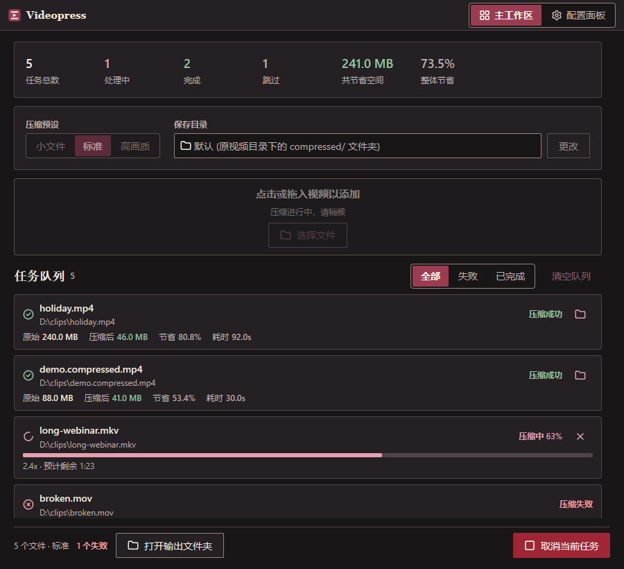
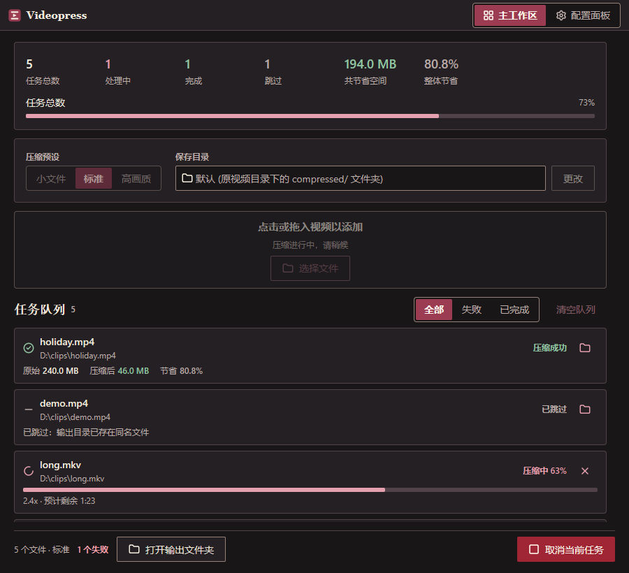
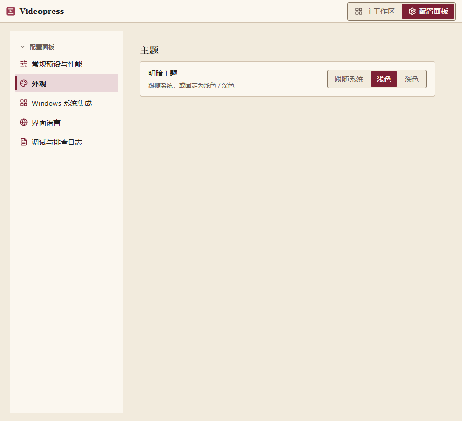

# Videopress

<p align="center">
  
  
  
  
  
  <a href="https://github.com/Shirolin/videopress/releases/latest"></a>
</p>

**Videopress** 是一个专为 Windows 系统设计的、基于 FFmpeg 的高颜值视频压缩工具。
它完美融合了**桌面图形界面 (GUI)** 与**控制台命令行 (CLI)** 双入口，不仅能满足日常拖拽和右键菜单快速压缩，还能完美适配终端效率工具流。
它免去了记忆 FFmpeg 复杂参数的烦恼，只提供精心调校的常用预设规格，同时支持并发队列、硬件加速自动探测以及系统右键集成。

<p align="center">
  
</p>

---

## 📥 下载安装

[**前往 Releases 下载最新版**](https://github.com/Shirolin/videopress/releases/latest)

| 方式 | 适合谁 | 下载文件 |
| :--- | :--- | :--- |
| 安装版 | 普通用户，想要开始菜单和卸载入口 | `videopress-setup-<版本>-amd64.exe` |
| 便携版 | 不想安装、想放 U 盘或固定目录 | `Videopress.exe` |

### 安装版

1. 下载 `videopress-setup-<版本>-amd64.exe`，双击运行。
2. 安装完成后从开始菜单启动 **Videopress**。
3. 首次启动若没找到 FFmpeg，引导页点「自动下载并配置」即可；也可以手动选择本机的 `ffmpeg.exe`。

### 便携版

1. 下载 `Videopress.exe`，放到一个单独的文件夹（例如 `D:\Tools\Videopress\`）。
2. 双击运行，无需安装、无需管理员权限。
3. FFmpeg 处理方式同上；想在离线机器上开箱即用，把 `ffmpeg.exe` 放在与 `Videopress.exe` 相同的目录即可。

### 关于 FFmpeg

Videopress 不内置 FFmpeg，按以下顺序查找：

1. 引导页自动下载（需要联网，来源为 npmmirror 的 ffmpeg-static）；
2. 与 `Videopress.exe` 同目录的 `ffmpeg.exe`；
3. 系统 `PATH` 中的 `ffmpeg.exe`；
4. 在引导页或「配置面板 → 关于」手动指定路径。

### Windows 提示与系统要求

- 程序暂未做代码签名，首次运行可能出现 SmartScreen「Windows 已保护你的电脑」：点 **更多信息 → 仍要运行**。
- 支持 Windows 10 / 11（x64）。
- 右键菜单、发送到、Path 等集成只写当前用户，无需管理员权限。
- 下载页附 `SHA256SUMS.txt`，可用 `Get-FileHash` 校验文件完整性。

---

## ⚡️ 快速上手

### 拖放压缩

打开程序，把视频拖进窗口或点「选择文件」，选择预设后点「开始压缩」。输出默认写入源视频旁边的 `compressed/` 文件夹，界面会显示整体进度、速度与剩余时间，支持逐个取消。

### 右键集成

在 **配置面板 → Windows 系统集成** 中打开需要的入口：

- **右键菜单**：资源管理器中右键视频 →「使用 Videopress 压缩」；
- **发送到菜单 (SendTo)**：右键 → 发送到 →「快速压缩视频」；
- 桌面快捷方式、开始菜单、用户 `Path` 也在这里一键开关。

多选文件右键打开时只会出现一个窗口，其余文件自动转交给已运行的实例。

<details>
<summary>命令行方式安装集成（可选）</summary>

```powershell
.\Videopress.exe --install-sendto   # 安装 SendTo 快捷方式
.\Videopress.exe --uninstall-sendto # 移除
.\Videopress.exe --install-path     # 把程序目录加入用户 Path
.\Videopress.exe --uninstall-path   # 移除
```
</details>

<p align="center">
  
  
  
</p>

---

## 🛠 运行工作流

```text
 ┌──────────┐      右键菜单 / 命令行 / GUI 拖拽      ┌────────────┐      自动探测 GPU      ┌─────────────┐
 │ 视频源文件 ├────────────────────────────────────>│ Videopress ├───────────────────────>│ 硬件加速编码 │
 └──────────┘                                        └─────┬──────┘  (NVENC / QSV / AMF)   └──────┬──────┘
                                                           │                                      │
                                                           ▼                                      ▼
                                                     ┌────────────┐                         ┌─────────────┐
                                                     │  并发队列  │                         │ FFmpeg 压缩 │
                                                     │ (Worker)   │                         └──────┬──────┘
                                                     └─────┬──────┘                                │
                                                           │                                      │
                                                           ▼                                      ▼
                                                     ┌────────────┐                         ┌─────────────┐
                                                     │ GUI / CLI  │<────────────────────────┤ 压缩完成输出 │
                                                     │ 进度与摘要  │                         │(compressed/)│
                                                     └────────────┘                         └─────────────┘
```

---

## ✨ 核心特性

* 🖥 **双入口无缝切换**：
  * **GUI 模式**：双击程序或不带参数运行时，展示基于 MyGO + MujicaUI 的原生图形界面。支持文件拖拽、压缩队列管理、全局设置配置及 GPU 加速检测切换。
  * **CLI 模式**：在终端附带视频文件路径运行时，自动进入控制台模式，实时渲染无抖动的平滑进度条，并在完成后输出直观的压缩率摘要表格。
* 🎨 **明暗主题**：默认跟随系统，可在「配置面板 → 外观」固定为浅色或深色。
* 🎞 **动图导出**：把队列一键导出为 GIF / APNG / WebP，内置流畅、均衡、高清三档，也能自定义起止时间、宽度、帧率与体积目标。
* 📊 **批量进度与取消**：整体进度、单文件速度与剩余时间、逐文件取消、按状态筛选队列。
* 🔧 **FFmpeg 一键配置**：未检测到时可在引导页自动下载，或手动指定 `ffmpeg.exe` 并随时恢复自动检测。
* 🚀 **GPU 硬件加速**：自动检测你显卡支持的硬编技术（NVIDIA `h264_nvenc`、Intel `h264_qsv`、AMD `h264_amf`）。检测到后自动开启加速，未检测到时安全 fallback 到 CPU 编码。
* 🧵 **高效并发**：通过 Worker Pool 机制实现多视频文件并发压缩。CLI 模式下并发数大于 1 时，进度条展示将优雅地降级为整洁的动态状态日志，避免终端闪烁。
* ✂️ **可选几何裁剪**：压缩前可先裁掉画面多余空边（如 AI 生成视频的安全边）。支持两种模式：精确像素裁剪 `W:H:X:Y`（与 ffmpeg crop 一致），或居中比例裁剪（如 `16:9` 的最大内接矩形，可再按百分比保留画面）；裁剪发生在缩放之前，硬编/音频/CRF 等行为不受影响。默认不裁。
* 📝 **自动日志归档**：压缩结束后，程序会在对应的输出目录自动创建/追加 `compress_summary.log`，供随时复盘压缩率和处理耗时。
* 🌐 **环境变量一键绑定**：支持通过 `--install-path` 自动将当前程序目录追加到 Windows 当前用户的 `Path` 环境变量中，同时支持 `--uninstall-path` 安全移除，实现跨终端随处调用。
* 🌐 **多语言与国际化支持 (i18n)**：
  * **界面与命令行全覆盖**：程序在 GUI（配置面板、弹窗、核心设置）与 CLI（终端用法、参数帮助、进度提示）中完全实现中/英文国际化。
  * **系统级 UI 语言自适应**：默认跟随系统显示语言加载中文或英文，可在设置页随时切换，重启后保持。
  * **右键菜单名称热重载**：在配置面板中切换语言时，如果已安装右键快捷菜单，程序会自动在注册表中覆盖修改 `MUIVerb`，实现右键菜单名称的热切换（中文：“使用 Videopress 压缩” / 英文：“Compress with Videopress”）。
  * **自定义语言选择**：配置面板提供“界面语言”下拉菜单，便于用户灵活手动指定首选语言。

---

## ⚙️ 预设说明

Videopress 内置了 3 档精心调校的 CRF 质量参数，满足不同场景下的压缩需求：

* 📱 **`small`**：低码率，适合聊天预览、移动端低流量快速分享。
* 🖥 **`standard`**（默认）：平衡档，保留优异画质的同时极大限度缩减体积，适合博客、网站、社媒发布。
* 🎨 **`quality`**：高码率，极致的画质还原，适合高清视频存档与展示。

---

## 💻 命令行选项

如果你习惯使用命令行，Videopress 提供了极简且强大的命令行标志：

| 长选项 | 短选项 | 默认值 | 说明 |
| :--- | :--- | :--- | :--- |
| `--preset <规格>` | - | `standard`| 压缩预设规格：`small` / `standard` / `quality` |
| `--concurrency <数>` | `-c` | `1` | 最大并发压缩任务数 |
| `--hw` | - | `false` | 自动探测并启用 GPU 硬件加速编码 |
| `--copy-audio` | `-a` | `false` | 音频流直通：不重新编码音频，保留原音质且加快速度 |
| `--force` | `-f` | `false` | 强制覆盖同名压缩文件，禁止创建自增副本 |
| `--skip-existing` | - | `false` | 增量模式：如果输出路径已存在同名压缩文件，则跳过 |
| `--crop <W:H:X:Y>` | - | 不裁 | 压缩前精确像素裁剪（如 `1600:900:160:90`），与 `--crop-center` 互斥 |
| `--crop-center <W:H>` | - | - | 压缩前居中裁到该比例的最大矩形（如 `16:9`），与 `--crop` 互斥 |
| `--crop-scale <数>` | - | `1.0` | 在居中比例框内再保留的画面比例（0.5–1.0，需配合 `--crop-center`） |
| `--install-sendto` | - | `false` | 安装 SendTo 右键菜单绑定 |
| `--uninstall-sendto`| - | `false` | 移除 SendTo 快捷方式（兼容清除旧版本） |
| `--install-path` | - | `false` | 将当前程序目录添加至当前用户的 Path 环境变量中 |
| `--uninstall-path`| - | `false` | 从当前用户的 Path 环境变量中安全移除程序目录 |

### 命令行进阶示例

```powershell
# 开启 GPU 加速，用 small 档压缩，并且直接 Copy 音轨（不编码音频）
videopress.exe --preset small --hw -a C:\videos\movie.mp4

# 压缩前先居中裁到 16:9 并保留 90% 画面（去掉 AI 生成的安全边）
videopress.exe --crop-center 16:9 --crop-scale 0.9 --hw C:\videos\border.mp4

# 压缩前按像素精确裁剪（W:H:X:Y，与 ffmpeg crop 语义一致）
videopress.exe --crop 1600:900:160:90 --preset standard C:\videos\delta.mp4

# 开启 3 并发，增量压缩整个文件夹中的视频，如果已经压缩过则直接跳过
videopress.exe -c 3 --skip-existing C:\videos\a.mp4 C:\videos\b.mp4 C:\videos\c.mp4

# 一键配置环境变量（使你在任意目录下均可直接调用 videopress）
videopress.exe --install-path
```

---

## 📦 自行构建

若需从源码构建，只需 Go 1.27.3；界面是纯 Go 自绘（[MyGO](https://github.com/egoist/mygo) + [MujicaUI](https://github.com/ELY-Open-Source/MujicaUI)），不需要 Node 或 C 编译器。

构建入口为 [`scripts/make.ps1`](scripts/make.ps1)：

```powershell
# 运行测试
pwsh -File scripts/make.ps1 test

# 开发窗口（热重载）
pwsh -File scripts/make.ps1 dev

# 发布完整版 GUI+CLI
pwsh -File scripts/make.ps1 build
```

已安装 `make` 时可用 `make test` / `make build` / `make ci`，逻辑相同。

编译产物输出在 `dist/windows-amd64/`（`Videopress.exe` 与安装器）。构建细节见 [`docs/ARCHITECTURE.md`](docs/ARCHITECTURE.md)，视觉规范见 [`docs/DESIGN.md`](docs/DESIGN.md)。
