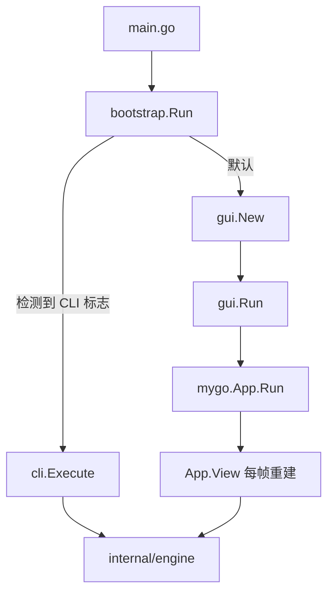

# Videopress 架构说明

## 目录结构

```text
videopress/
├── main.go                 # 极简入口，调用 bootstrap.Run
├── mygo.json               # 应用元数据：名称、标识、版本、图标、输出目录
├── resources/icon.png      # 打包用图标
├── scripts/make.ps1        # 统一构建入口（Makefile 转发到这里）
├── internal/
│   ├── bootstrap/          # CLI/GUI 模式分发
│   ├── cli/                # 命令行入口与参数解析
│   ├── gui/                # MyGO + MujicaUI 原生界面
│   │   ├── run.go          # 窗口、语言与启动期探测
│   │   ├── app.go          # 界面状态与后台任务
│   │   ├── view.go         # 根视图：标题栏 + 页面切换 + toast
│   │   ├── workspace.go    # 工作区：预设、拖放、队列、动图导出
│   │   ├── settings.go     # 配置页：预设、系统集成、语言、调试
│   │   ├── prefs.go        # settings.json 读写
│   │   └── i18n.go         # zh/en 文案表
│   ├── locale/             # 系统 UI 语言检测（CLI 用）
│   ├── engine/             # 压缩调度
│   ├── ffmpeg/             # FFmpeg 探测与命令
│   ├── compress/           # 预设与路径
│   ├── env/                # Path 环境变量
│   ├── notify/             # 系统通知
│   ├── sendto/             # 右键集成
│   └── util/               # 工具函数
├── docs/
│   ├── ARCHITECTURE.md     # 本文件
│   └── DESIGN.md           # 视觉契约
└── dist/windows-amd64/     # go tool mygo build 产物（exe + 安装器）
```

## 启动流程



界面是纯 Go 自绘（MyGO），没有 WebView、前端构建或 Go↔JS 绑定。`App.View` 每帧重建整棵视图树，所有跨帧状态都放在 `gui.App` 的字段里。

## 线程模型

- 压缩、动图导出、FFmpeg 下载、系统集成检测在 goroutine 里跑。
- 回到主线程改状态并重绘用 `App.update`（内部 `Window.Update`）。
- 压缩与导出各有 `context.CancelFunc` 和代数（`compressGen` / `gifGen`），防止旧任务回调覆盖新状态。

## 持久化

| 内容 | 位置 |
|------|------|
| 预设、并发、编码、裁剪、输出目录、语言偏好 | `%APPDATA%\Videopress\settings.json` |
| 界面语言（MyGO 自己维护） | `%APPDATA%\vp\locale` |
| 窗口尺寸与位置 | MyGO 的窗口状态，`StateKey: "main"` |
| GPU 编码器探测缓存 | `%LOCALAPPDATA%` 下的 `videopress_gpu.cache` |

## 视觉

全部颜色、字号、间距来自 MujicaUI 的 `core.Tokens` / `core.Density` / `theme`，不在本仓库自建色板。见 [`DESIGN.md`](DESIGN.md)。

## 构建命令

统一入口为 [`scripts/make.ps1`](../scripts/make.ps1)（Windows 推荐）或 [`Makefile`](../Makefile)（需安装 `make`）：

```powershell
# 开发窗口（热重载）
pwsh -File scripts/make.ps1 dev

# 测试 / 静态检查 / 编译检查
pwsh -File scripts/make.ps1 test
pwsh -File scripts/make.ps1 vet
pwsh -File scripts/make.ps1 build-go

# 发布构建：dist/windows-amd64/ 下的 exe 与安装器
pwsh -File scripts/make.ps1 build

# 与 CI 相同
pwsh -File scripts/make.ps1 ci
```

要求 Go 1.27.3，不需要 Node。

## 版本注入

版本号写在 [`mygo.json`](../mygo.json) 的 `version` 里。`go tool mygo build` 把它注入进二进制，应用启动时由 `mygo.App.Version()` 读出并赋给 `cli.Version`，所以 GUI 标题栏、关于信息与 `--version` 用的是同一个号。

纯 CLI 构建路径仍可用 ldflags 覆盖：

```text
-X videopress/internal/cli.Version=<version>
```

默认版本定义在 [`internal/cli/app.go`](../internal/cli/app.go) 的 `Version` 变量。
